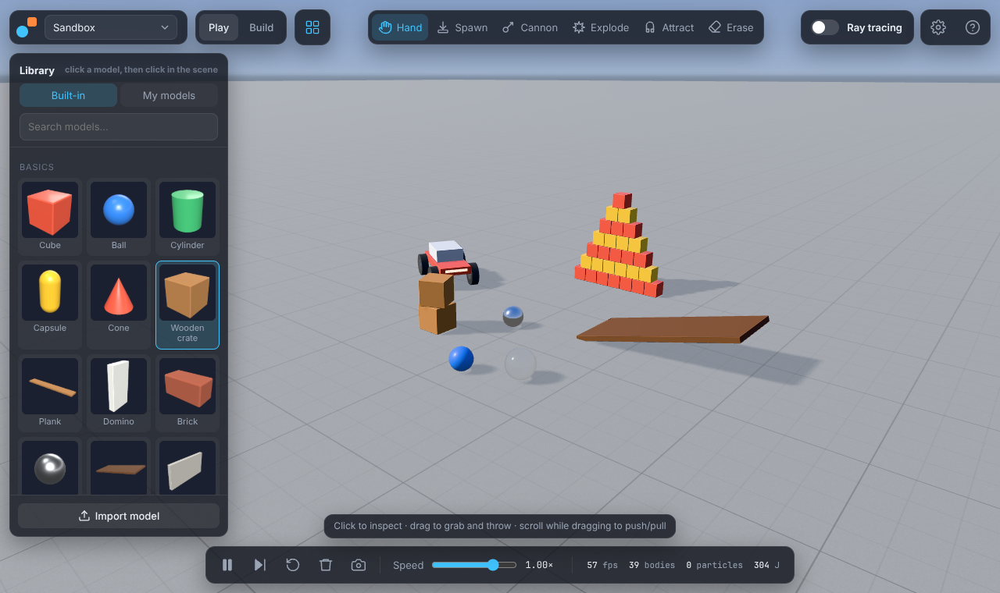
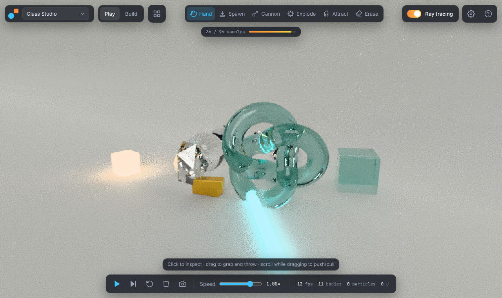
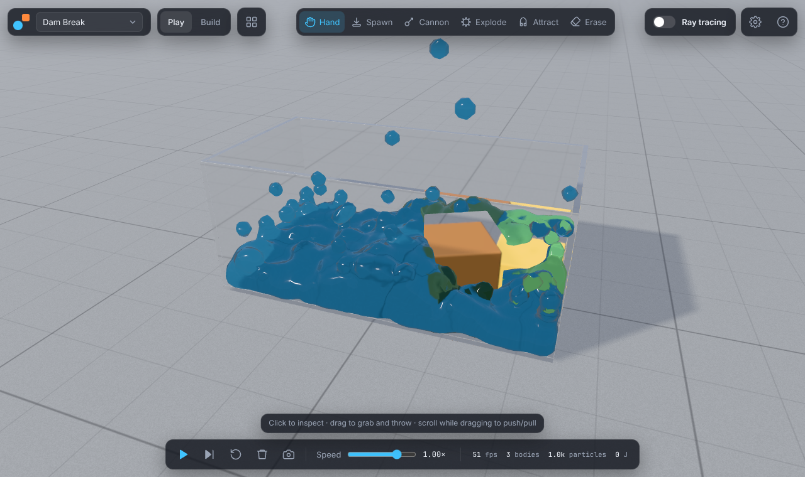
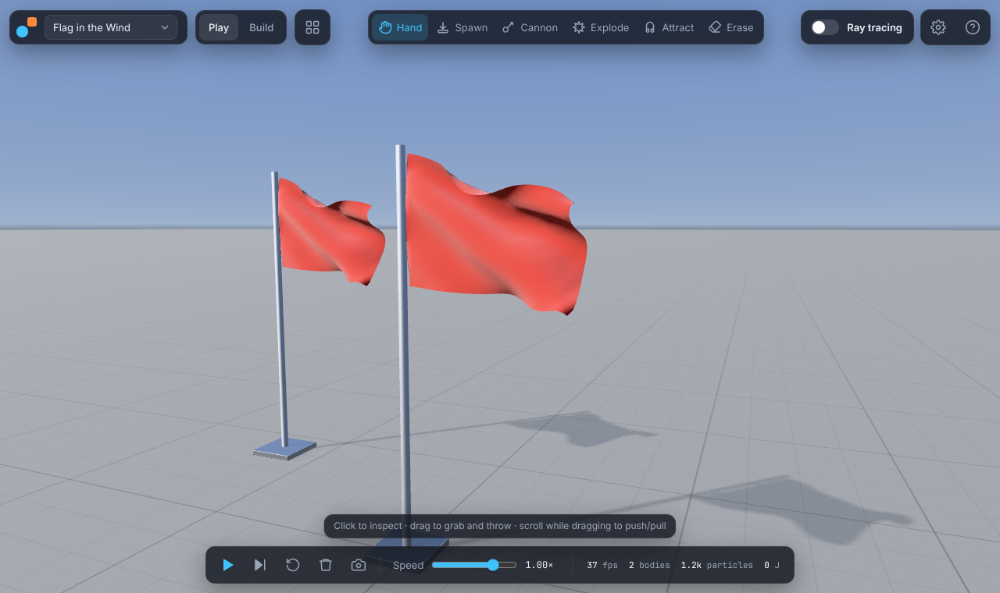

# Physics Sim

An interactive physics sandbox for the browser and the Mac. Throw, stack, explode and build things with:

- rigid bodies, joints and motors
- cloth, soft bodies and water
- orbital (n-body) gravity

Switch on **ray tracing** to see the scene with physically based light.



| Path-traced studio | Dam break | Wind and cloth |
|---|---|---|
|  |  |  |

*These screenshots come from a headless test machine with software rendering, so the path tracer is at low resolution and sample count. On a real GPU it converges to a clean image in seconds.*

## What you can do

- **Pick it up in a minute.** A short welcome and an optional guided tour on first launch. Objects light up under the cursor, and the hint bar says what a click will do. Drag any model from the library straight into the scene. Made a mess? **Undo** (Ctrl/⌘ + Z) takes back adds, deletes, explosions, throws and scene changes.
- **Play.** Grab and throw objects; their mass matters. You also have a cannon, explosions, an attractor beam, an eraser, slow motion and single-frame stepping.
- **Change the physics:**
  - gravity presets for Earth, Moon, Mars, Jupiter and zero-g
  - n-body mode, where everything attracts everything
  - attractor-only mode
  - wind with gusts, and air drag
  - solver settings

  The common ones are big buttons under **Quick settings**: gravity, wind, speed, look and ray-tracing quality. Everything else is under **Advanced**.
- **Ray tracing.** A progressive GPU path tracer ([three-gpu-pathtracer](https://github.com/gkjohnson/three-gpu-pathtracer)) renders:
  - soft shadows from a physically sized sun
  - reflections, glass and water refraction, and emissive lights
  - depth of field: double-click to focus
  - a denoiser, and photo export

  While the simulation runs it shows a fast live preview. Press **Render still** (or pause), and the image converges; **Save** keeps the picture. Fast / Balanced / Best quality presets.
- **Materials.** Each preset sets both the look and the physics: steel, chrome, gold, rubber, wood, glass, diamond, ice, foam, fabric, jelly, neon and more. Choosing *steel* makes the object 7,850 kg/m³ as well as shiny.
- **Model library.** 60+ built-in models: basics, materials, machines (motor car, Newton's cradle, pendulum, wrecking ball, windmill, catapult, chain), structures (Jenga, dominoes, brick wall, bridge, Galton board, glass tank), soft & fluid (flags, curtain, trampoline, jelly, balloon, water, hose), space (stars and planets) and fun (ragdoll, bowling, teapot).
- **16 scenes in a gallery:** Sandbox, Empty World, Newton's Cradle, Domino Run, Jenga, Bowling, Wrecking Ball, Galton Board, Orbits, Three-Body Figure-8, Dam Break, Cloth Drape, Flag in the Wind, Jelly Playground, Glass Studio and Moon Base.
- **Model Builder.** Assemble shapes into bodies with Move / Turn / Resize handles and optional snapping (5 cm, 15°). New shapes stack on the selected part instead of overlapping. Connect parts by picking a joint (hinge, ball, glue, slider, spring or rope), then clicking two parts, or one part and empty space to pin it to the world. Joints can have limits and motors. Add cloth, jelly or water. Test-run the model with every Play tool, then save it to your library or export it as `.glb` (for Blender) or `.physmodel.json`. A checklist walks you through your first model.
- **Blender.** Import `.glb`, `.gltf`, `.obj` and `.stl`. The [Blender add-on](blender/physics_sim_addon.py) tags objects with physics settings and joints, then exports in one click. The Mac app hot-reloads every export. See **[docs/BLENDER.md](docs/BLENDER.md)**.
- **Save and load whole scenes** as JSON.

## Get it

- **Web — desktop, phone or tablet:** **<https://just-rice.github.io/physics-sim/>** (once GitHub Pages is enabled; see *Hosting* below). On a phone, use **Share → Add to Home Screen** (iPhone) or **⋮ → Install app** (Android) and it opens full-screen like an app. To run it locally, use the commands below, then open the URL Vite prints.

  ```bash
  npm ci
  ```

  ```bash
  npm run dev
  ```

- **Mac:** download the `.dmg` from Releases or from the **Mac app (.dmg)** workflow. See **[docs/MAC.md](docs/MAC.md)** for the first-launch step and what the app adds: multithreaded solver, Blender live link, native menus and offline use.

## Controls

| Key | Action |
|---|---|
| `1`–`6` | Hand · Place · Cannon · Explode · Attract · Erase |
| `Space` / `.` | Pause / step one frame |
| `Ctrl/⌘ Z` / `Ctrl/⌘ ⇧ Z` | Undo / redo |
| `R` | Reset the scene to how it started |
| `T` | Ray tracing on/off |
| `B` / `Esc` | Model Builder / back to Play |
| `L` / `G` | Library / settings |
| `F` / `Del` | Focus / delete the selection |
| `P` | Save an image |
| `H` | Help (and replay the tour) |

Drag on empty space to orbit, right-drag to pan, and scroll to zoom. While grabbing, scroll to push the object away or pull it closer. Drag a model from the library into the scene to place it exactly, or double-click it to drop it in the middle of the view.

**On phones and tablets** one finger uses the current tool and two fingers turn, pan and zoom the camera. Tap a model in the library, then tap where it should go; hold a model for more options (drop it in view, edit it in Build, export). Undo and redo are the arrows in the bottom bar, and Attract has a Pull / Push switch. The layout follows the screen: sheets on narrow phones, side panels in landscape, clear of the notch and home bar. Phones start with lighter settings (fewer particles, Fast ray tracing), and the resolution drops automatically if a device can't keep up, then climbs back when it can. Saved pictures go through the share sheet, so you can save them straight to Photos.

In the Builder: `W` / `E` / `R` move, turn or resize; hold `Shift` while dragging to flip snapping; `Esc` cancels a joint in progress.

## How it works

| Part | Implementation |
|---|---|
| Rigid bodies & joints | [Rapier](https://rapier.rs) (WebAssembly), fixed 1/120 s step with render interpolation. N-body gravity is applied as impulses (symplectic), so orbits keep their energy. |
| Cloth, soft bodies, fluids | A custom **XPBD** particle solver ([`src/physics/particles`](src/physics/particles)): distance/bending constraints, global volume and shape matching, and Position Based Fluids with wall boundary density. Particles collide two-way with every rigid shape, so things float and get pushed. |
| Threads | When the page is cross-origin isolated, the particle arrays live on `SharedArrayBuffer`s. A worker pool runs the neighbour search, density, contact and viscosity kernels with `Atomics` barriers. Results are bit-identical to the single-threaded path. |
| Rendering | three.js with a procedural HDR sky/studio, plus a marching-cubes water surface. |
| Ray tracing | three-gpu-pathtracer, loaded on demand. The BVH is refit or rebuilt as things move, with a short sample history while live. |
| Models | One JSON format ([`src/models/schema.ts`](src/models/schema.ts)) shared by the library, builder, importer and exporter. Physics data rides in glTF *extras*, so models round-trip through Blender. |
| Desktop | Electron ([`desktop/`](desktop)): an `app://` protocol with isolation headers and CSP, a sandboxed preload bridge, menus and the watched folder. |

## Development

| Command | What it does |
|---|---|
| `npm run dev` | Dev server with COOP/COEP headers, so threads work |
| `npm test` | Vitest: rigid bodies, motors, figure-8 orbit energy, cloth, soft-body volume, fluid settling and floating, import conventions, model round-trips |
| `npm run build` | Type-check and production build into `dist/` |
| `npm run desktop` | Build, then run the desktop app |
| `npm run dist:mac` | Build the `.dmg` (on macOS) |

## Hosting

- `.github/workflows/deploy-pages.yml` publishes `dist/` to GitHub Pages on every push to `main`. To turn it on once, go to **Settings → Pages → Source: GitHub Actions**.
- `.github/workflows/mac-dmg.yml` builds the `.dmg` on a macOS runner when run by hand or when you push a `v*` tag.
- `.github/workflows/ci.yml` type-checks, tests and builds every push.

## License

MIT
